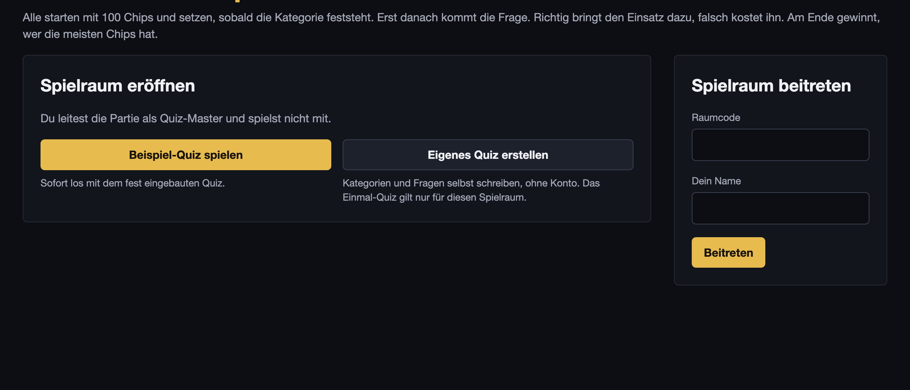

# Quiz-Poker

Online-Quiz im Browser für Spieleabende in der Freundesrunde: Alle setzen Pokerchips auf ihr Wissen, bevor die Frage
kommt. Richtig bringt den Einsatz dazu, falsch kostet ihn. Am Ende gewinnt, wer die meisten Chips hat.

**Live:** https://quiz-poker.quiz-poker.workers.dev (Beispiel-Quiz ohne Anmeldung spielbar)



## Wie gespielt wird

Ein Quiz-Master eröffnet einen Spielraum und leitet die Partie, die Spieler treten mit Raumcode und Namen bei, jeder am
eigenen Gerät. Jede Runde ist eine Frage:

1. Die Kategorie erscheint, alle setzen geheim.
2. Die Frage erscheint, alle tippen ihre Antwort.
3. Der Quiz-Master markiert die Antworten als richtig oder falsch.
4. Auflösung: Die Chips ändern sich, alle sehen Einsätze, Antworten und Ergebnis.

Das Quiz kommt entweder fest eingebaut oder entsteht im Editor als Einmal-Quiz für einen Spielraum.

## Technik

| Bereich | Umsetzung |
|---|---|
| Oberfläche | Svelte 5 mit Vite, eine einzelne Seite, TypeScript |
| Server und Echtzeit | Cloudflare Workers, ein Durable Object je Spielraum, WebSockets |
| Konten und Daten | Better Auth mit Einladungscode, Cloudflare D1 |
| Tests | Vitest, die Server-Tests laufen in der Laufzeit von Cloudflare |
| Qualität | ESLint, Prettier, `svelte-check`, CI mit GitHub Actions bei jedem Pull Request |

## Entscheidungen

- **Der Server ist die Wahrheit:** Spielstand, Einsätze und Lösungen liegen auf dem Server. Jedes Gerät bekommt nur, was
  seine Rolle gerade sehen darf. Lösungen und fremde Einsätze gehen erst bei der Auflösung hinaus (`src/regeln/ansicht.ts`).
- **Regeln ohne Technik:** Die Spielregeln in `src/regeln/` sind reines TypeScript ohne Svelte und Cloudflare und
  testgetrieben entstanden.
- **Ein Raum, ein Durable Object:** Jedes Objekt speichert nach jeder Aktion und schläft im Leerlauf, ohne dass die
  WebSocket-Verbindungen abreißen.

Begründungen und verworfene Alternativen stehen als ADRs (Architecture Decision Records) in [`docs/adr/`](docs/adr/).

## Lokal starten

```bash
npm ci          # Abhängigkeiten installieren
npm run dev     # App und Worker lokal starten
npm run check   # Linter, Formatprüfung, Typprüfung, Tests und Build
```

Für die Konten braucht `npm run dev` eine Datei `.dev.vars`, siehe [`docs/Arbeitsumgebung.md`](docs/Arbeitsumgebung.md).

## Stand

Spielbar sind Partien mit dem Beispiel-Quiz und mit eigenen Einmal-Quizzen. Quiz-Master können ein Konto mit
Einladungscode anlegen. Als Nächstes speichern sie ihre Quizze dort, danach folgen öffentliche Quizze und Kopien. Die Roadmap steht in [`docs/Projektvision.md`](docs/Projektvision.md).

## Wie es entsteht

Das Projekt ist ein Lernprojekt. Ich entwickle es mit Claude Code als KI-Werkzeug: Plan, Entscheidungen und Prüfung liegen
bei mir, Tests und CI prüfen jede Änderung. Pläne, Lernjournale und Notizen liegen in [`docs/`](docs/).
